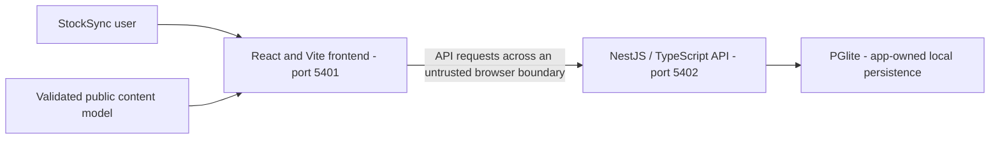
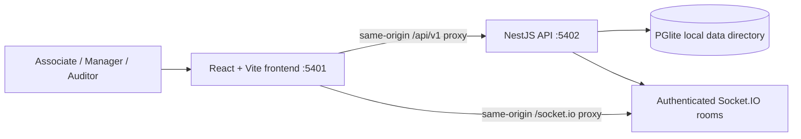
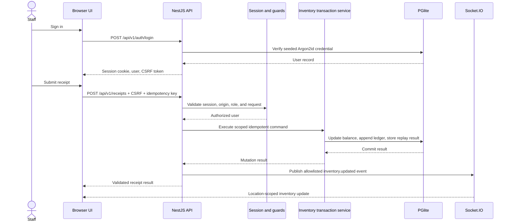
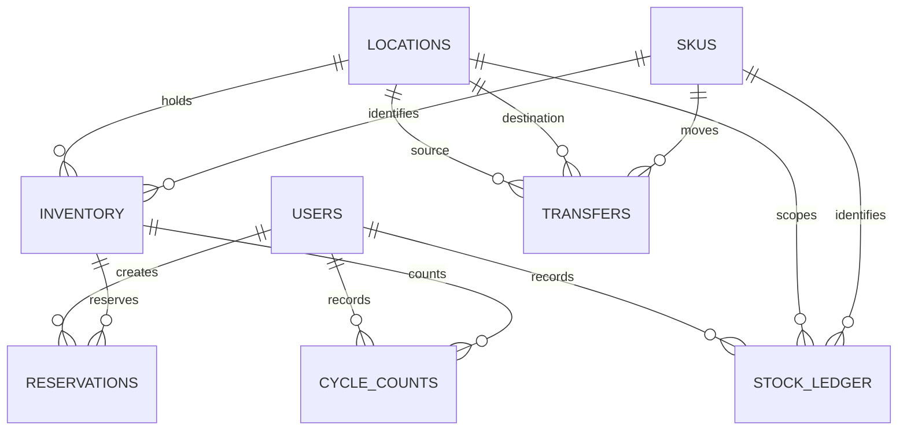

# StockSync Frontend Architecture

Maintained in this independent Git repository at **docs/architecture.md**. Updated **2026-11-09**. The guide covers the implemented stack, interfaces, data model, operational limits, and release requirements.

## Contents

1. [Scope, users, and repository boundary](#1-scope-users-and-repository-boundary)
2. [Context, containers, and trust boundaries](#2-context-containers-and-trust-boundaries)
3. [Source ownership and module map](#3-source-ownership-and-module-map)
4. [Screens, navigation, and lifecycle](#4-screens-navigation-and-lifecycle)
5. [Primary workflows and recovery](#5-primary-workflows-and-recovery)
6. [Domain, persistence, and data ownership](#6-domain-persistence-and-data-ownership)
7. [API and internal contracts](#7-api-and-internal-contracts)
8. [Security, privacy, and egress](#8-security-privacy-and-egress)
9. [Design, accessibility, and platform adapters](#9-design-accessibility-and-platform-adapters)
10. [Build, checks, and deployment](#10-build-checks-and-deployment)
11. [Architecture decisions and tradeoffs](#11-architecture-decisions-and-tradeoffs)
12. [Requirements traceability](#12-requirements-traceability)
13. [Dated verification and limitations](#13-dated-verification-and-limitations)
14. [Extension rules and companion repository](#14-extension-rules-and-companion-repository)

## 1. Scope, users, and repository boundary

Multi-location inventory operations for associates, managers, and auditors.

Inventory lookup, receiving, transfers, cycle counts, reservations, stock ledger, and authenticated Socket.IO updates.

This repository owns the React/Vite web interface, public content, interaction state, and API adapter. The API owns authoritative domain records and permission decisions.

There are two independent Git roots for this application, each with its own README and architecture guide. A parent app/workspace folder is a checkout convenience. Use synthetic records; current local services remain on loopback.

### Scope

StockSync is APP-03, a local portfolio demonstration for multi-location synthetic inventory. The React frontend and NestJS API are separate Git repositories. The parent StockSync folder is a VS Code multi-root workspace, not a combined Git repository.

The current implementation uses an embedded PGlite database so local development works without Docker or a separate PostgreSQL server. It preserves PostgreSQL SQL semantics for this demo; this is not a production database deployment.

the relevant configuration or validation section in this guide documents the selected
API origins and isolated E2E commands for mock and live-selection modes.

## 2. Context, containers, and trust boundaries



The browser must not grant roles or confirm prices, balances, payments, stock, or workflow completion based only on local state.

### Containers



Trust boundaries:

- The browser is an untrusted client. Search, filters, role selection, location IDs, quantities, and notes are validated or authorized by the API.
- The local API binds to loopback. Vite proxies browser calls to the API, avoiding a browser-held service key.
- The API owns inventory state. The browser never calculates authoritative balances or prices.
- Socket.IO uses the same server-side session as HTTP and assigns room subscriptions based on the authenticated role and home location.
- PGlite files remain local under `stocksync-backend/data/stocksync/` unless `STOCKSYNC_DATA_DIR` is set.

## 3. Source ownership and module map

| Owner/path                                                                                                                                                                                                                                                                                                             | Responsibility                                                     |
| ---------------------------------------------------------------------------------------------------------------------------------------------------------------------------------------------------------------------------------------------------------------------------------------------------------------------- | ------------------------------------------------------------------ |
| [src/main.tsx](../src/main.tsx)                                                                                                                                                                                                                                                                                        | Web entry and composition                                          |
| [src/api/client.ts](../src/api/client.ts)                                                                                                                                                                                                                                                                              | API transport and response boundary                                |
| [src/config/mock-mode.ts](../src/config/mock-mode.ts)                                                                                                                                                                                                                                                                  | Build-time API mode selection                                      |
| [src/content.tsx](../src/content.tsx)                                                                                                                                                                                                                                                                                  | Content loading/provider contract                                  |
| [src/content-schema.ts](../src/content-schema.ts)                                                                                                                                                                                                                                                                      | Runtime boundary validation                                        |
| [src/App.tsx](../src/App.tsx)<br>[src/features/auth/LoginScreen.tsx](../src/features/auth/LoginScreen.tsx)<br>[src/features/inventory/OperationDialog.tsx](../src/features/inventory/OperationDialog.tsx)<br>[src/features/workspace/AuthenticatedWorkspace.tsx](../src/features/workspace/AuthenticatedWorkspace.tsx) | Screens, composition, and interaction owners; see screen inventory |
| [src/App.css](../src/App.css)<br>[src/index.css](../src/index.css)                                                                                                                                                                                                                                                     | Authored styling and adaptation rules                              |
| [public/stocksync-model.json](../public/stocksync-model.json)                                                                                                                                                                                                                                                          | Active public content/locale contract; no private credentials      |
| [e2e](../e2e)                                                                                                                                                                                                                                                                                                          | Existing test/support directory; configured does not mean rerun    |
| [src/test](../src/test)                                                                                                                                                                                                                                                                                                | Existing test/support directory; configured does not mean rerun    |
| [.github/workflows](../.github/workflows)                                                                                                                                                                                                                                                                              | Configured CI; hosted outcomes require separate verification       |
| [src/api/client.test.ts](../src/api/client.test.ts)<br>[src/App.test.tsx](../src/App.test.tsx)                                                                                                                                                                                                                         | Examples of existing colocated tests                               |

The source map follows the existing framework directories and test placement.

## 4. Screens, navigation, and lifecycle

UI entry and interaction owners:

- [src/App.tsx](../src/App.tsx)
- [src/features/auth/LoginScreen.tsx](../src/features/auth/LoginScreen.tsx)
- [src/features/inventory/OperationDialog.tsx](../src/features/inventory/OperationDialog.tsx)
- [src/features/workspace/AuthenticatedWorkspace.tsx](../src/features/workspace/AuthenticatedWorkspace.tsx)
- [src/features/workspace/WorkspaceChrome.tsx](../src/features/workspace/WorkspaceChrome.tsx)
- [src/StockSyncApp.tsx](../src/StockSyncApp.tsx)

The active model is [public/stocksync-model.json](../public/stocksync-model.json). Preserve existing loading, empty, validation, permission, success, and failure states; model text does not provide server identity. This is a web SPA; the current source owns view/tab selection and component lifecycle. The Vercel rewrite is hosting configuration, not an additional UI router. Follow the authored source for request cancellation, retry, focus cleanup, and local preference behavior; do not infer an offline queue where none exists.

## 5. Primary workflows and recovery

### Implemented Design Patterns and Use Cases

- **Layered modular monolith:** NestJS controllers validate/authorize requests, inventory application services implement commands and reads, `InventoryTransactionService` owns transaction/idempotency boundaries, and `DatabaseService` owns PGlite access.
- **Ledger-backed inventory:** receipts, transfers, adjustments, and count variances append stock-ledger movements alongside balance changes. Reservations change available/reserved quantities without pretending to be a completed sale.
- **Optimistic concurrency and idempotency:** cycle counts submit the inventory version they observed; commands store request hashes and replay validated results for the same key. Reusing a key with a different payload is rejected.
- **Commit-before-notify:** allowlisted inventory events publish after a successful, non-replayed command; room membership is assigned from the authenticated server session and location scope.

| Use case         | Actor and server-owned result                                                                                                                                                                      | Failure/recovery behavior                                                                                                                                          |
| ---------------- | -------------------------------------------------------------------------------------------------------------------------------------------------------------------------------------------------- | ------------------------------------------------------------------------------------------------------------------------------------------------------------------ |
| Receive stock    | Associate or manager records an inbound quantity and ledger movement at an authorized location.                                                                                                    | Unknown inventory/location is rejected; same-key retries do not duplicate stock or publish a second event.                                                         |
| Transfer stock   | Manager creates an in-transit transfer, atomically reducing available source stock; an authorized destination user receives it, increasing destination stock and recording the inbound ledger row. | Same-location, unavailable stock, missing destination inventory, or resolved transfer is rejected; transaction rollback preserves balances and ledger consistency. |
| Cycle count      | Associate or manager records observed stock against the version read from inventory; variance is audited and ledgered.                                                                             | Stale versions or a count below reserved units conflict and require refreshing/recounting. Zero variance is recorded without an unnecessary balance-change event.  |
| Adjust stock     | Manager records a signed manual quantity adjustment with a note.                                                                                                                                   | A change that would reduce on-hand below reserved quantity is rejected without applying the adjustment.                                                            |
| Reserve/release  | Associate or manager reserves available units for a workflow, then releases the active reservation when no longer needed.                                                                          | Insufficient available stock, missing reservation, or an already released reservation is rejected; a retry uses the original idempotency key.                      |
| Review inventory | Authorized users browse location-scoped inventory, overview, ledger, transfers, and reservations; auditor is read-only.                                                                            | Unauthenticated users, out-of-home associates, invalid filters, and auditor mutations are denied before state changes.                                             |

### Receive Sequence



Invalid authorization or schema input is rejected before the stock transaction. A transaction failure rolls back the balance, ledger row, and idempotency record together; replayed commands do not publish a second stock event.

## 6. Domain, persistence, and data ownership

The frontend consumes server-owned domain records; its model supplies presentation and synthetic display content. Local UI state cannot replace backend transaction or authorization decisions.

### Data Model



`inventory` stores on-hand, reserved, and optimistic version values with database checks. `stock_ledger` records movements. Transfers and reservations have explicit state. State-changing operations and their ledger entries are committed transactionally with bounded idempotency records.

## 7. API and internal contracts

The companion API contract is in [stocksync-backend](https://github.com/gopichand-retail-apps/stocksync-backend). It remains the authority for request/response shapes; the local typed/validated adapter is in the source map. Keep public paths, status/error envelopes, headers, payload validation, and compatibility tied to that source.

### HTTP and Event Contracts

All API routes are under `/api/v1`.

| Route                                                                                 | Authorization                                | Purpose                                              |
| ------------------------------------------------------------------------------------- | -------------------------------------------- | ---------------------------------------------------- |
| `GET /health`                                                                         | Public, local only                           | Process health contract                              |
| `POST /auth/login`                                                                    | Public, rate limited                         | Argon2id demo login; rotates the session ID          |
| `GET /auth/synthetic-roles`                                                           | Public, development only                     | Active role codes only; no identities or credentials |
| `GET /auth/session`                                                                   | Public                                       | Current server-side session and CSRF token           |
| `POST /auth/logout`                                                                   | Authenticated + CSRF                         | Destroy session                                      |
| `GET /locations`, `/inventory`, `/overview`, `/ledger`, `/transfers`, `/reservations` | Authenticated                                | Read models with associate location scope            |
| `POST /receipts`, `/transfers`, `/cycle-counts`, `/adjustments`, `/reservations`      | Authenticated, CSRF, role gated              | Validated idempotent state changes                   |
| `PATCH /transfers/:id/receive`, `/reservations/:id/release`                           | Authenticated, CSRF, role and resource scope | Resolve transfer or reservation                      |

All request bodies, query objects, IDs, and idempotency keys are parsed against strict Zod schemas. State changes use the `Idempotency-Key` header and return stable error codes with request IDs.

The source default is `isMock=true` in `stocksync-frontend/src/config/mock-mode.ts`;
`VITE_IS_MOCK` is a build/development-server override. The mode selects the API endpoint
only. In both modes, role codes come from `GET /auth/synthetic-roles`, credentials are
validated by `POST /auth/login`, and session/role/ownership checks remain backend-owned.
No client-selected role or user ID authorizes an API request, and the content model contains
no password. The API hides synthetic-role discovery and refuses startup in production until
production identity/session controls are implemented.

Mock mode uses `VITE_MOCK_API_BASE_URL` when configured; local Vite development may use the
loopback `/api/v1` proxy or legacy `VITE_API_BASE_URL`. Production mock deployment requires
an explicit test API base URL. Live mode requires `VITE_REAL_API_BASE_URL` and never falls
back to the mock endpoint. These Vite variables are public build-time settings, not secrets.
The isolated E2E runner tests both modes against a seeded API on ports 5403/5404 with
in-memory PGlite and makes the unselected endpoint unreachable; live-selection E2E verifies
routing, not a real database integration.

Stock-change events contain only location ID, SKU ID, version, and event type. Associates subscribe only to their home-location room; managers and auditors subscribe to the global read room. Events publish to the affected location and global readers after the database operation commits.

The versioned [OpenAPI 3.1 contract](https://github.com/gopichand-retail-apps/stocksync-backend/blob/main/docs/openapi.yaml) documents HTTP request/response shapes, cookie authentication, CSRF, idempotency headers, and common error responses. Strict Zod schemas remain the runtime enforcement boundary; the OpenAPI file is a maintained contract, not generated from those schemas.

## 8. Security, privacy, and egress

Current release limitation: **The OpenAPI duplicate mapping is corrected. Archived npm start scripts still use Unix syntax. Production sessions, persistence, retry safety, and WebSocket hosting require separate validation.**

Only the local simulator controls in the current source are implemented. CORS, a role label, and mode selection do not provide a new production identity boundary.

Keep private credentials out of public models, browser bundles, logs, URLs, and source archives. No additional runtime network destination or external service is configured. Keep logs limited to the source-defined request/trace and safe aggregate fields. Backups, retention, deletion, and real-user ownership need explicit product/operations decisions before external exposure.

## 9. Design, accessibility, and platform adapters

The existing product styling is authored in [src/App.css](../src/App.css), [src/content-model.css](../src/content-model.css), [src/index.css](../src/index.css). Preserve its tokens, layout density, fonts/assets, breakpoints, and component states. User-facing strings/locale rules follow the active validated model. WCAG 2.2 AA is a target, not a verified conformance claim: keyboard/focus/dialog behavior, zoom/reflow, contrast, reduced motion, and screen readers require their applicable checks. No redesign or new visual measurements were performed here. Native/mobile packaging and device adapters are **not implemented by this web repository**.

## 10. Build, checks, and deployment

Configured npm scripts, from this repository with Node **24.15.0**; use `npm.cmd` in PowerShell:

| Command                    | Actual manifest definition                              |
| -------------------------- | ------------------------------------------------------- |
| `npm.cmd run dev`          | `vite`                                                  |
| `npm.cmd run build`        | `tsc -b && vite build`                                  |
| `npm.cmd run lint`         | `eslint .`                                              |
| `npm.cmd run format:check` | `prettier --check "src/**/*.{ts,tsx}" "*.{ts,js,json}"` |
| `npm.cmd run test`         | `vitest run`                                            |
| `npm.cmd run test:cov`     | `vitest run --coverage`                                 |
| `npm.cmd run test:e2e`     | `playwright test`                                       |
| `npm.cmd run preview`      | `vite preview`                                          |

Install with `npm.cmd ci` and retain [package-lock.json](../package-lock.json). Registry access is required for a clean dependency installation. These commands describe the configured checks; execution results are listed in section 13.

Frontend address: http://127.0.0.1:5401. API health: http://127.0.0.1:5402/api/v1/health. Vercel uses [vercel.json](../vercel.json) and the documented keys in [.env.vercel.example](../.env.vercel.example). The static output is dist; SPA fallback excludes API/socket paths. The environment example is not automatically loaded under that filename. Public endpoints and mode selectors are build inputs; rebuild/redeploy after changes. A hosted frontend still requires an independently verified API.

CI configuration is listed in section 3. Run the configured checks before merging or releasing. Deployment requires separate verification of the selected hosting environment.

## 11. Architecture decisions and tradeoffs

### Implemented Design Patterns and Use Cases

- **Layered modular monolith:** NestJS controllers validate/authorize requests, inventory application services implement commands and reads, `InventoryTransactionService` owns transaction/idempotency boundaries, and `DatabaseService` owns PGlite access.
- **Ledger-backed inventory:** receipts, transfers, adjustments, and count variances append stock-ledger movements alongside balance changes. Reservations change available/reserved quantities without pretending to be a completed sale.
- **Optimistic concurrency and idempotency:** cycle counts submit the inventory version they observed; commands store request hashes and replay validated results for the same key. Reusing a key with a different payload is rejected.
- **Commit-before-notify:** allowlisted inventory events publish after a successful, non-replayed command; room membership is assigned from the authenticated server session and location scope.

| Use case         | Actor and server-owned result                                                                                                                                                                      | Failure/recovery behavior                                                                                                                                          |
| ---------------- | -------------------------------------------------------------------------------------------------------------------------------------------------------------------------------------------------- | ------------------------------------------------------------------------------------------------------------------------------------------------------------------ |
| Receive stock    | Associate or manager records an inbound quantity and ledger movement at an authorized location.                                                                                                    | Unknown inventory/location is rejected; same-key retries do not duplicate stock or publish a second event.                                                         |
| Transfer stock   | Manager creates an in-transit transfer, atomically reducing available source stock; an authorized destination user receives it, increasing destination stock and recording the inbound ledger row. | Same-location, unavailable stock, missing destination inventory, or resolved transfer is rejected; transaction rollback preserves balances and ledger consistency. |
| Cycle count      | Associate or manager records observed stock against the version read from inventory; variance is audited and ledgered.                                                                             | Stale versions or a count below reserved units conflict and require refreshing/recounting. Zero variance is recorded without an unnecessary balance-change event.  |
| Adjust stock     | Manager records a signed manual quantity adjustment with a note.                                                                                                                                   | A change that would reduce on-hand below reserved quantity is rejected without applying the adjustment.                                                            |
| Reserve/release  | Associate or manager reserves available units for a workflow, then releases the active reservation when no longer needed.                                                                          | Insufficient available stock, missing reservation, or an already released reservation is rejected; a retry uses the original idempotency key.                      |
| Review inventory | Authorized users browse location-scoped inventory, overview, ledger, transfers, and reservations; auditor is read-only.                                                                            | Unauthenticated users, out-of-home associates, invalid filters, and auditor mutations are denied before state changes.                                             |

The two Git repositories remain separate. Each owns one maintained README and this repository-local architecture guide. Shared application behavior may be described here for contract context, but implementation changes belong to the owning source module.

## 12. Requirements traceability

| Capability                      | Acceptance                                                        | Owner/path                         | Current status                                                | Evidence                               | Risk                                                                                                                                                                                             |
| ------------------------------- | ----------------------------------------------------------------- | ---------------------------------- | ------------------------------------------------------------- | -------------------------------------- | ------------------------------------------------------------------------------------------------------------------------------------------------------------------------------------------------ |
| Repository-local architecture   | Guide available in this checkout and linked from README           | docs/architecture.md; README.md    | Documented and validated                                      | File, link, and diagram checks         | Keep documentation consistent with source changes                                                                                                                                                |
| UI composition and API boundary | Preserve existing workflows and failure states                    | src/api/client.ts and source map   | Implemented; application verification limits are listed below | Current source and existing app design | The OpenAPI duplicate mapping is corrected. Archived npm start scripts still use Unix syntax. Production sessions, persistence, retry safety, and WebSocket hosting require separate validation. |
| Public deployment               | Verified identity, data durability, recovery, and hosted behavior | Existing deployment/API boundaries | Needs separate hardening/verification                         | No new hosted evidence                 | Local checks do not establish production readiness                                                                                                                                               |

## 13. Dated verification and limitations

Last documentation review: **2026-11-09**. The checks below distinguish documentation validation from application and deployment testing.

- Repository-local guide, README link, source-path references, section/contents anchors, and Mermaid syntax: passed documentation validation.
- New application tests/builds, coverage, dependency audits, browser/device accessibility/performance, hosted CI, and Vercel deployment: **not rerun for the documentation updates**.
- Frontend production builds passed on 2026-11-09 with Node 24.15.0. Build success does not establish that all application quality gates pass.
- Outstanding baseline limit: The OpenAPI duplicate mapping is corrected. Archived npm start scripts still use Unix syntax. Production sessions, persistence, retry safety, and WebSocket hosting require separate validation.

The baseline results below record earlier validation. Re-run the listed commands against the current revision before release.

Previously recorded application verification:

### Local Verification

Run the API from `stocksync-backend` with `npm run start:dev`, then the frontend from `stocksync-frontend` with `npm run dev`. The frontend binds to `5401`, the API to `5402`, and both are loopback-only.

Use these checks from the corresponding repository:

```sh
# stocksync-frontend
npm run format:check
npm run lint
npm run test:cov
npm run test:e2e
VITE_IS_MOCK=false npm run test:e2e
npm run build

# stocksync-backend
npm run format:check
npm run lint
npm run test:cov
npm run test:e2e
npm run build
npm audit --audit-level=high
```

Latest frontend coverage passed 91 tests: 95.54% statements, 91.36% branches,
91.80% functions, and 96.59% lines. Latest backend coverage passed 68 tests:
97.17% statements, 91.63% branches, 96.09% functions, and 97.78% lines. The
aggregate 90% gates pass. Additional 95% frontend file gates cover mode
selection, role mapping, login, and inventory-operation mapping; backend
per-file 95% gates cover inventory reads, stock changes, and transfers.
Coverage data does not include CSS. `src/main.tsx` is excluded as bootstrap
wiring and is exercised by the browser tests.

Playwright ran two selected-API flows per mode: seeded-user login/workspace and
manager stock receipt. The API E2E suite passed 10 workflows, including transfer,
cycle count, adjustment, reservation, and release. Browser E2E is not source
coverage. The E2E runners use separate 5403/5404 ports and in-memory PGlite;
the persistent local PGlite directory and already-running 5401/5402 services
were not reused or modified. The browser suite is not run by the standalone
frontend CI because its sibling API repository is not checked out there.

Some individual auth and inventory service branch ratios remain below the
95% critical-module target because one V8 branch maps to each Nest decorator;
the actual request, role, concurrency, and transaction branches are covered.
This is recorded as an unmet per-file threshold, not a coverage pass. A
multi-client Socket.IO deployment test, full workflow through the browser,
Core Web Vitals, and a complete WCAG/axe audit remain outstanding.

## 14. Extension rules and companion repository

Start with [README.md](../README.md) and this guide. The companion repository is [stocksync-backend](https://github.com/gopichand-retail-apps/stocksync-backend); clone the pair as siblings when using the existing local integration/model contract. This guide is inside the current repository and does not depend on a parent-folder architecture file to exist.

Update this guide when owned source, routes, persistence, identity, UI states, egress, or deployment behavior changes. Coordinate public contract changes with the companion repository and tests. Preserve existing data, run isolated checks with synthetic records, record failures, and review release and infrastructure changes before publication.
